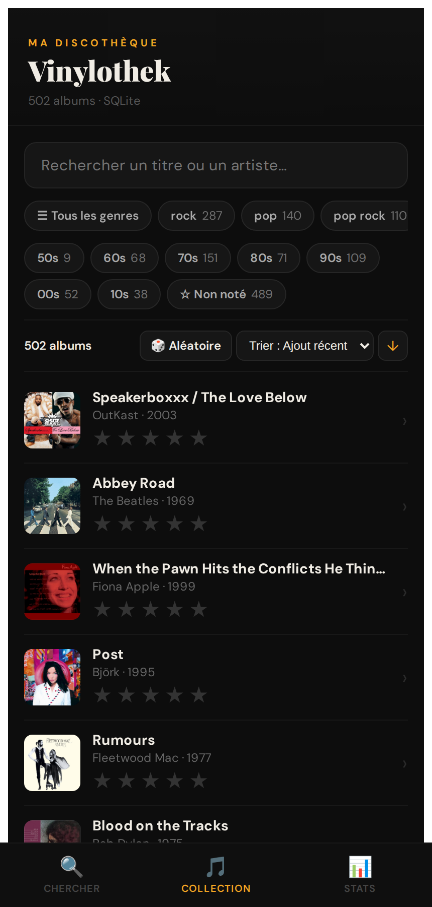
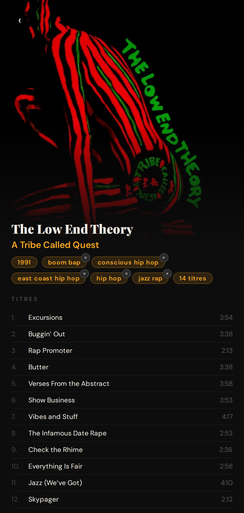
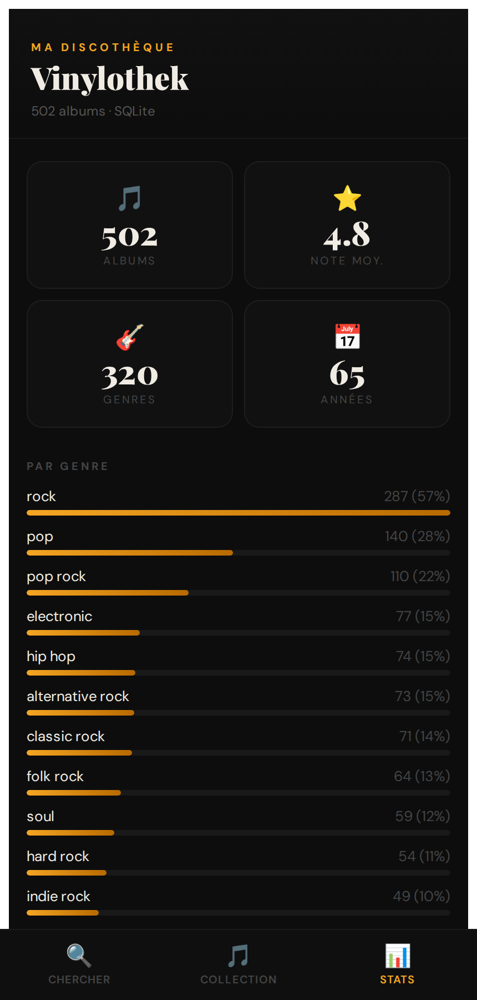
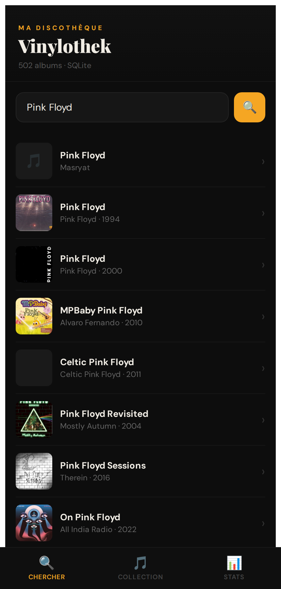
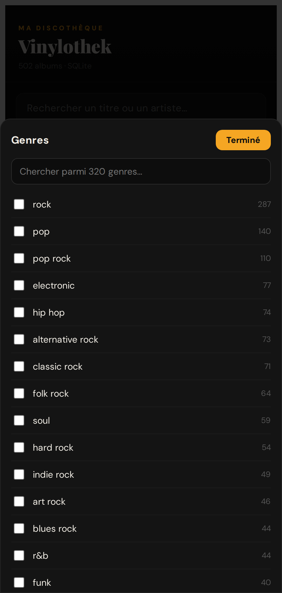
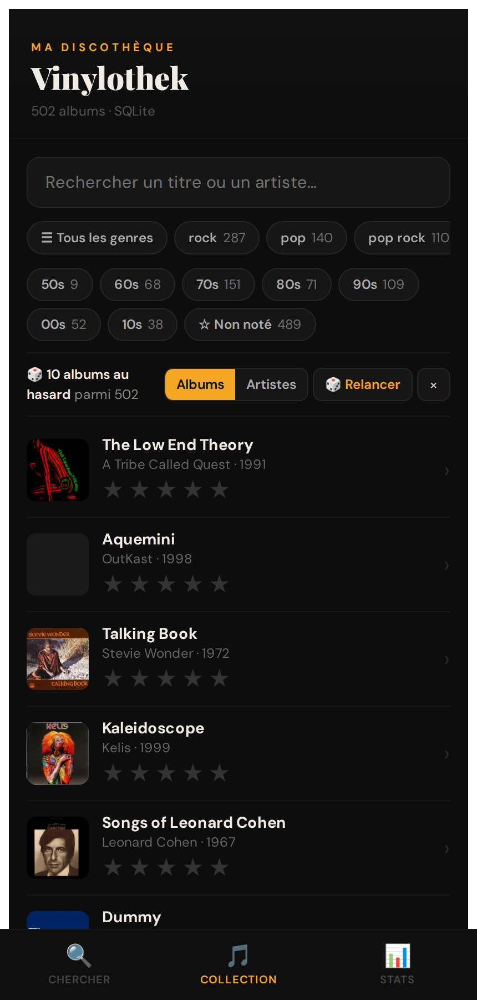

# Vinylothek

Application web personnelle pour gérer une collection de vinyles : on cherche un album sur MusicBrainz, on l'ajoute à sa discothèque, on le note et on le commente, puis on parcourt la collection avec des filtres, des tirages au hasard et des statistiques.

L'interface est pensée pour le mobile (colonne de 480 px, navigation en bas d'écran) et fonctionne aussi bien sur ordinateur.

<p align="center">
  
  
  
</p>

## Fonctionnalités

### Recherche et ajout

L'onglet **Chercher** interroge MusicBrainz et affiche les pochettes du Cover Art Archive. Depuis la fiche d'un résultat, on ajoute l'album à la collection avec une note et un commentaire.



### Collection

L'onglet **Collection** liste les albums enregistrés, avec :

- une recherche par titre ou par artiste ;
- des filtres par genre (les plus fréquents en raccourci, tous les autres dans un sélecteur avec recherche), par décennie et « Non noté » ;
- un tri par date d'ajout, artiste, titre, année ou note, croissant ou décroissant ;
- le bouton **Aléatoire**, qui tire 10 albums ou 10 artistes au hasard parmi les albums filtrés.

<p>
  
  
</p>

### Fiche album

La fiche affiche la pochette, l'année, les genres (on peut retirer ceux qui ne conviennent pas), la liste des titres avec leur durée, ma note et mon commentaire. Elle ajoute des informations récupérées ailleurs :

- la note communautaire **Discogs** ;
- la langue et les exemplaires vendus, depuis **Wikidata** ;
- un lien vers l'album sur **Deezer**.

Si l'album a un identifiant Deezer qui n'est pas encore renseigné sur Wikidata (propriété P2723), la fiche propose de l'y ajouter avec un compte Wikidata.

### Statistiques

L'onglet **Stats** donne le nombre d'albums, la note moyenne, la répartition par genre et par année, et les coups de cœur notés 5 étoiles.

## Architecture

```
navigateur ──► Vite + React (localhost:5173)
                    │
                    ▼
              proxy.py — Flask (localhost:5000)
                    │
        ┌───────────┼──────────────────────────┐
        ▼           ▼                          ▼
  vinylothek.db   cache des API        MusicBrainz, Cover Art Archive,
  (SQLite)        (table api_cache)    Deezer, Wikidata, Discogs
```

- **Front** : une seule application React ([src/App.jsx](src/App.jsx)), servie par Vite.
- **Proxy** ([proxy.py](proxy.py)) : sert l'API de la collection (`/collection`) et relaie les appels aux services externes. Il respecte la limite de MusicBrainz (une requête par seconde) et garde les réponses dans la table `api_cache` pour ne pas redemander ce qu'il connaît déjà. Seul le front Vite (`localhost:5173`) est autorisé à l'appeler.
- **Base** : `vinylothek.db`, créée automatiquement au premier lancement. Elle n'est pas versionnée.

## Installation

Prérequis : Node.js 18 ou plus et Python 3.

```bash
# Front
npm install

# Proxy
python3 -m venv venv
source venv/bin/activate
pip install -r requirements.txt
```

Pour la note Discogs, crée un fichier `.env` à la racine avec un jeton personnel ([discogs.com/developers](https://www.discogs.com/developers/)) :

```
DISCOGS_TOKEN=ton_jeton
```

Sans jeton, l'application marche quand même, mais sans la note Discogs.

## Lancement

Dans deux terminaux :

```bash
source venv/bin/activate
python proxy.py          # http://localhost:5000
```

```bash
npm run dev              # http://localhost:5173
```

Puis ouvre http://localhost:5173.

## Scripts de maintenance

Tous les scripts travaillent sur `vinylothek.db`. Fais une copie de la base avant de les lancer.

| Script | Rôle |
|---|---|
| [import_rolling_stone.py](import_rolling_stone.py) | Importe les albums de la liste Rolling Stone 500 ([rolling_stone_500.csv](rolling_stone_500.csv)), sans la musique classique. Options `--limit N` et `--start N`. |
| [fix_rolling_stone.py](fix_rolling_stone.py) | Corrige les albums Rolling Stone associés à la mauvaise fiche MusicBrainz et importe ceux qui manquent, en deux temps : `propose propositions.json` (ne modifie rien), puis `apply propositions.json` après relecture. Le proxy doit tourner pour l'étape `apply`. |
| [fill_years.py](fill_years.py) | Complète les années de sortie manquantes, depuis le cache puis MusicBrainz. Option `--dry-run`. |
| [fill_tracks.py](fill_tracks.py) | Récupère les titres des albums qui n'en ont pas, en passant par le proxy (qui doit tourner). Peut être relancé sans risque. |
| [migrate.py](migrate.py) | Migration ponctuelle de l'ancienne version, qui stockait la collection dans le `localStorage` du navigateur : `python migrate.py export.json`. |

## Sources de données

- [MusicBrainz](https://musicbrainz.org) : albums, artistes, titres, genres
- [Cover Art Archive](https://coverartarchive.org) : pochettes
- [Wikidata](https://www.wikidata.org) : langue, ventes, lien Deezer
- [Deezer](https://www.deezer.com) : écoute
- [Discogs](https://www.discogs.com) : note communautaire
